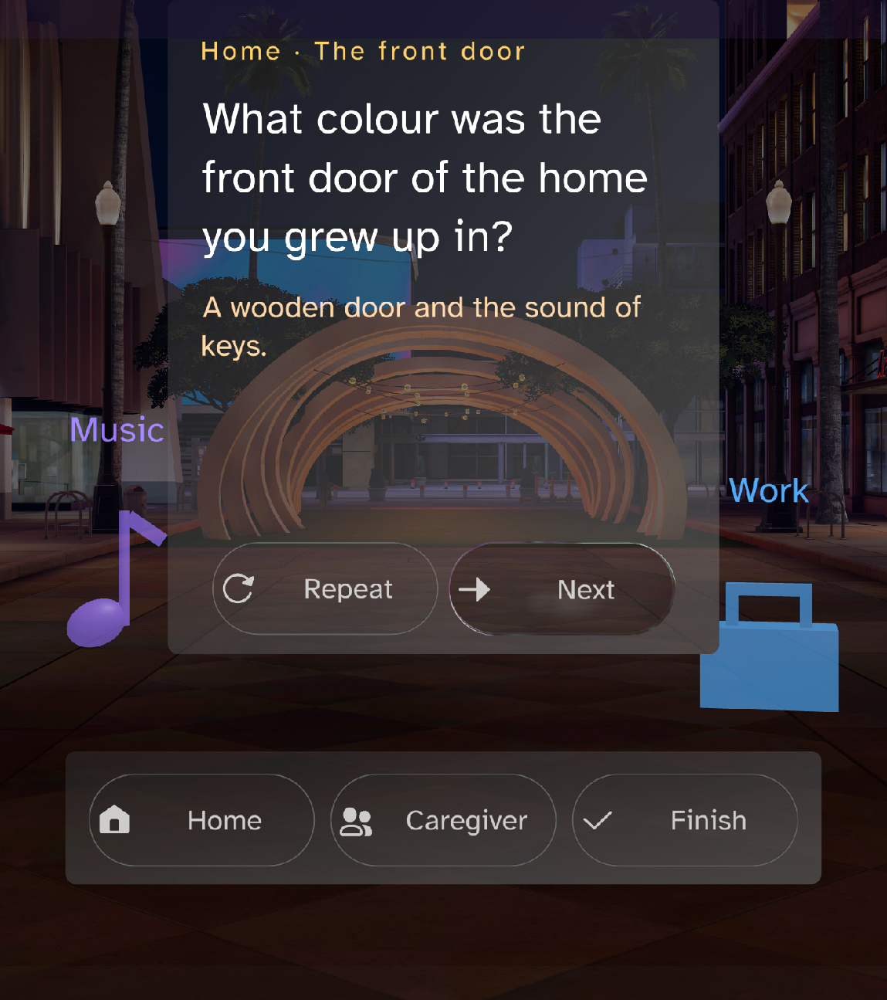

# Memory Place

**A reminiscence space for Snap Spectacles, used together with a caregiver.**
Built for the [Learn AR with SPECS](https://learn-specs.devpost.com/) hackathon with Lens Studio, CLAD and the Lens Studio MCP.

## The problem

Reminiscence (talking about familiar places, people and routines) is one of the gentlest ways to connect with someone living with mild cognitive impairment or Alzheimer's. In practice it happens with photo albums or a tablet: the person looks down at a screen, the caregiver looks over their shoulder, and the conversation competes with the device.

## The idea

Memory Place turns the room into the memory aid. Six familiar places stand around the person on a 2.6 m ring: **Home, Family, Music, Work, Garden and Travel**. They walk to one, pinch it, and a single memory card opens, with one open question and one sensory cue. The caregiver stands beside them, sees the same card, and can reveal a follow-up question to keep the conversation going.

- **The place is the cue.** Spatial memory is stronger than a list on a screen.
- **Hands and eyes stay free:** pinch to open, repeat, move on, return home or finish.
- **A calm pace:** each card unfolds in steps (the question first, then the sensory cue, then the caregiver note). **Repeat** plays it again from the start when the person needs a moment.
- **No pressure:** no score, no timer, no wrong answer, no red error state. Finishing a place marks it *Done*; finishing the session shows a thank-you and a warm recap of the places visited today.
- **Caregiver co-pilot:** caregiver mode shows a short follow-up to read aloud, without taking over.

## Who it is for

Older adults living with mild cognitive impairment or Alzheimer's, always with a caregiver or family member. **It is not a medical device**: it makes no diagnosis, treatment or clinical claim. The 36 prompts are new and fictional; in real use a caregiver would replace them with the person's own memories.

## Designed for the glasses

- **Legible from 1.5–2.5 m.** Atkinson Hyperlegible, a typeface designed for low-vision readers. The question is 4.4 cm tall at 1.5 m, set in light text on a dark frosted card for the additive display.
- **One task on screen.** One memory at a time; Repeat and Next never move, so they are always where the person expects them.
- **Big, calm targets.** 22 cm wide buttons from the Spectacles UI Kit with system icons. Places grow slightly when aimed at.
- **The card comes to the place.** When a place is opened, the card glides around the person to sit right beside it, so they never have to look away from the cue. Home brings it back to the front.
- **Distinct places, not just colours.** Each place has its own shape (house, heart, music note, toolbox, tree, suitcase), colour and text label, so it works for colour-blind users.
- **Room scale.** Places sit at chest height around the starting point and turn to face the person.

## How it was built

1. **Planned** with the Devpost Learn skill pack: design brief, design principles, scene plan and test plan are in [`app/devpost/`](app/devpost/).
2. **Logic first:** a pure TypeScript state machine (`MemoryPlaceCore.ts`) with 12 Node tests, and a validated JSON dataset of 6 places × 6 memories.
3. **Built with CLAD through the Lens Studio MCP.** A coding agent drove Lens Studio directly through the MCP server; no scene was assembled by hand. The exact build prompt is in [`app/devpost/clad-build-prompt.md`](app/devpost/clad-build-prompt.md):
   - **Scene and wiring:** created the hierarchy, attached the scripts and wired every `@input` (scene-graphql, VirtualScene).
   - **Assets:** generated the primitive meshes and materials for the six places, imported the Atkinson Hyperlegible font, and installed LEAF from the Asset Library.
   - **Verification loop:** after every change it recompiled TypeScript, refreshed the preview, read the runtime logs, queried the live scene graph, and captured the preview to check layout and legibility. That loop caught a start-up order crash, text 10× too small to read, and places floating above eye level, all fixed before submission.
   - **API grounding:** checked Lens Studio, Spectacles Interaction Kit, UI Kit and LEAF behaviour against the knowledge base and package sources instead of guessing.
4. **Tested with LEAF**, also run through the MCP: 8 scenarios drive real Spectacles Interaction Kit pinches in the preview (all six places present, open a memory, Repeat, Next, finish a place, Caregiver, Home, Finish). All 8 pass.

| Layer | File |
|---|---|
| State machine (no Lens APIs) | `app/Assets/Scripts/MemoryPlaceCore.ts` |
| Data (generated from JSON) | `app/Assets/Scripts/MemoryPlaceData.ts` ← `app/devpost/memory-place.json` |
| Card, buttons, labels (UI Kit) | `app/Assets/Scripts/MemoryPlaceUI.ts` |
| Places, pinches, flow | `app/Assets/Scripts/MemoryPlaceMain.ts` |
| LEAF scenarios | `app/Assets/Tests/` |

## Try it

1. Install [Lens Studio 5.25](https://lensstudio.com/download) (Windows 11 or macOS 12+).
2. Open `app/MemoryPlace.esproj`.
3. In the Preview panel choose a Spectacles device and **Interactive** input. Move with WASD and click to pinch.
4. Optional: `cd app && npm test` runs the 12 state-machine tests. The LEAF panel runs the 8 scene scenarios.

More detail: [`app/README.md`](app/README.md).

## Privacy, safety and provenance

- No camera, recording, identification or tracking of people; no personal data.
- Not a medical device; designed to be used with a caregiver.
- All code and content were created during the hackathon. Third-party components (Spectacles UI Kit, Spectacles icons, Atkinson Hyperlegible, LEAF) are listed in [`app/devpost/provenance.md`](app/devpost/provenance.md).
