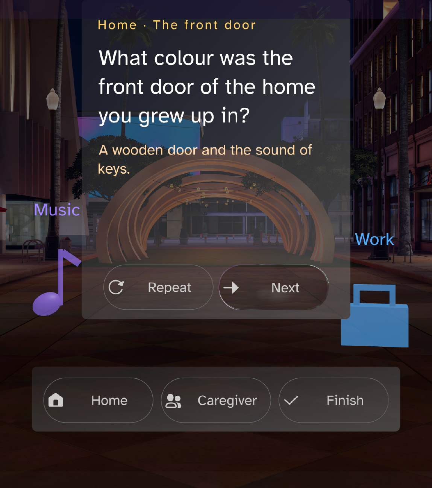

# Memory Place: Lens Studio project

This folder is the Lens Studio project root (`MemoryPlace.esproj`) for **Memory Place**, a reminiscence Lens for Snap Spectacles used with a caregiver. For the pitch, see the [repository README](../README.md).



## Experience

- **6 familiar places** on a 2.6 m ring around the person: Home, Family, Music, Work, Garden and Travel.
- Each place holds **6 memories**: an open question, a sensory cue and a caregiver follow-up.
- The person walks to a place and pinches it; one memory card opens and glides around them to sit beside that place, so they never have to look away from it. **Home** brings it back to the front.
- Each card unfolds in steps: the question, then the sensory cue, then (in caregiver mode) the follow-up.
- **Repeat** plays the same memory again from the start; **Next** moves to the next one. After six, the place is marked *Done* and the welcome card returns.
- **Caregiver** toggles a follow-up question for the caregiver to read aloud.
- **Home** resets the session; **Finish** closes it with a thank-you and a recap of the places visited ("Today you visited Home and Music."). There is no score, timer or failure state.

## Scene

```
ThemeManager      UI Kit theme (System 3)
Camera Object     Device Tracking: World
Lighting
InteractionKit    Spectacles Interaction Kit
UIRoot            (0, 0, -150) · MemoryPlaceUI (card, buttons, labels)
MemoryPlaceRoot   MemoryPlaceMain (places, pinches, flow)
  AnchorRoot      (0, -140, 0): places sit at chest height
Tests             LeafIndex (LEAF scenarios)
```

`UIRoot` sits above `MemoryPlaceRoot` so `MemoryPlaceUI` wakes before `MemoryPlaceMain` uses it. Full wiring: [`devpost/scene-plan.md`](devpost/scene-plan.md).

## Code

```
Assets/Scripts/
├── MemoryPlaceCore.ts   pure state machine (no Lens APIs)
├── MemoryPlaceData.ts   generated from devpost/memory-place.json
├── MemoryPlaceUI.ts     UI Kit card, buttons, icons, place labels
└── MemoryPlaceMain.ts   places, primitive placeholders, pinch handling
Assets/Tests/            LEAF scenarios + LeafIndex
Assets/Placeholders/     primitive meshes and materials for the six places
Assets/Fonts/            Atkinson Hyperlegible
tests/core.test.mjs      12 Node tests for the state machine
tools/                   validate, generate and render the dataset
devpost/                 brief, principles, scene plan, test plan, data, provenance, video script
```

## Validate and test

```bash
cd app
npm run preview   # validate the JSON, regenerate MemoryPlaceData.ts, render the 2D design preview
npm test          # 12 state-machine tests
```

In Lens Studio, open the LEAF panel and run the 8 scenarios: `ring`, `open_memory`, `repeat`, `next`, `finish_place`, `caregiver`, `home`, `end`.

## Done criteria

| # | Criterion | Evidence |
|---|---|---|
| 1 | Six places on a 2.6 m ring, each with a large label | LEAF `ring` + preview |
| 2 | Pinching a place opens one card with a prompt and a sensory cue | LEAF `open_memory` |
| 3 | Repeat shows the same card without changing progress | LEAF `repeat` |
| 4 | Next advances to the next memory of the same place | LEAF `next` |
| 5 | Six memories return to the welcome state and mark the place *Done* | LEAF `finish_place` + preview |
| 6 | Caregiver shows the follow-up question | LEAF `caregiver` |
| 7 | Home resets; Finish shows a thank-you with no score | LEAF `home`, `end` |
| 8 | Works in the Lens Studio preview without glasses | All of the above run in preview |

Comfort, reading distance and scale on real glasses are not yet verified.

## Safety

Not a medical device. No camera, recording, identification or personal data. Use with a caregiver.
